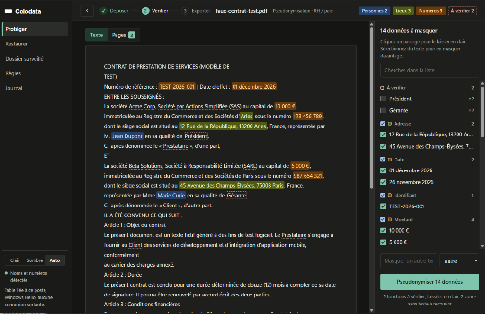

# Celodata

Celodata remplace les données personnelles d'un document français par des jetons, sur votre machine, avant l'envoi à une IA. Il remet ensuite les vraies valeurs dans la réponse.

Il sait aussi caviarder un document : les données sont alors retirées pour de bon, sans retour possible.

```
Document d'origine        Ce que l'IA reçoit              Réponse restaurée
------------------        ------------------              -----------------
Bonjour Mme Durand,       Bonjour Mme PERSONNE_1,         Mme Durand doit
votre IBAN FR76 3000…     votre IBAN IBAN_1 est           confirmer son IBAN
est enregistré.           enregistré.                     FR76 3000…
```



Le projet est libre (Apache 2.0) et en cours de construction. Il se lance depuis le code source : il n'y a pas encore d'installeur.

## Sommaire

- [Pourquoi](#pourquoi)
- [Ce que Celodata fait et ne fait pas](#ce-que-celodata-fait-et-ne-fait-pas)
- [Comment ça marche](#comment-ça-marche)
- [Les deux façons de l'utiliser](#les-deux-façons-de-lutiliser)
- [Installer](#installer)
- [L'appli Windows](#lappli-windows)
- [La passerelle serveur](#la-passerelle-serveur)
- [Sécurité](#sécurité)
- [Le code](#le-code)
- [Mesure et tests](#mesure-et-tests)
- [Limites connues](#limites-connues)

## Pourquoi

Beaucoup d'entreprises interdisent les assistants IA par peur de la fuite de données. Celodata leur donne un filtre local, vérifiable et en français, pour qu'elles puissent autoriser ces outils. Il sert aussi à sensibiliser l'employé : l'aperçu lui montre ce que son document contient avant qu'il ne parte.

## Ce que Celodata fait et ne fait pas

| Il fait | Il ne fait pas |
|---|---|
| Détecter les données personnelles d'un texte français et les remplacer par des jetons | Garantir l'anonymat : une donnée pseudonymisée reste une donnée personnelle au sens du RGPD |
| Montrer ce qui a été détecté et laisser corriger avant l'envoi | Empêcher un employé de coller un document non filtré dans une IA |
| Remettre les vraies valeurs dans la réponse de l'IA | Filtrer les images contenues dans un Word ou un Excel |
| Caviarder un document : rectangles noirs sur un PDF, marque `█████` ailleurs | Restaurer un document caviardé |
| Supprimer pour de bon les mots de passe, jetons et clés d'API | Rendre un secret supprimé : il n'est pas restauré au retour |
| Tout traiter sur le poste, sans connexion sortante ni télémétrie | Récupérer une table dont le mot de passe est perdu |

## Comment ça marche

Un texte suit cinq étapes.

1. **Détection.** Deux détecteurs lisent le texte. Les règles reconnaissent les formats fixes (mail, téléphone, numéro de sécurité sociale, SIRET, IBAN, plaque, adresse IP, date) et vérifient les clés de contrôle quand il y en a. Le modèle d'entités local — par défaut [`fastino/gliner2-privacy-filter-PII-multi`](https://huggingface.co/fastino/gliner2-privacy-filter-PII-multi) (GLiNER2-PII, licence Apache 2.0, tourne sur CPU sans carte graphique) — reconnaît ce qui n'a pas de format : noms, organisations, adresses, matricules, montants, noms de projets.
2. **Fusion.** Quand deux détections se chevauchent, la plus longue l'emporte, puis celle au score le plus élevé. Chaque valeur trouvée une fois est ensuite recherchée dans tout le texte. Les règles du projet (termes toujours ou jamais masqués) passent avant le reste.
3. **Aperçu.** L'utilisateur voit les passages surlignés. Il peut en retirer ou en ajouter. Chaque correction est retenue pour les textes suivants.
4. **Remplacement.** Chaque valeur reçoit un jeton lisible, par exemple `PERSONNE_12`. La même valeur reçoit toujours le même jeton dans une table donnée. Les secrets ne reçoivent pas de jeton : ils deviennent `[SECRET_SUPPRIMÉ]`.
5. **Retour.** Dans la réponse de l'IA, les jetons sont retrouvés et remplacés par les vraies valeurs. Les formes qu'une IA produit en recopiant sont reconnues aussi : `Personne 12`, `PERSONNE-12`, `[PERSONNE_12]`. Un jeton inconnu de la table est laissé tel quel et signalé.

La correspondance entre valeurs et jetons est rangée dans une **table** : un fichier chiffré, protégé par un mot de passe, qui ne quitte pas la machine.

### Pseudonymiser ou caviarder

Le choix se fait au dépôt du document, avant l'analyse. Il vaut aussi pour un dossier entier.

| | Pseudonymiser | Caviarder |
|---|---|---|
| Ce que devient une donnée | Un jeton, par exemple `PERSONNE_1` | Une marque noire |
| Retour possible | Oui, avec la table | Non |
| Rangé dans la table | La valeur, chiffrée | Rien |
| Usage | Travailler avec une IA puis restaurer sa réponse | Transmettre un document à un tiers |

### Types de fichiers

| Fichier | Pseudonymisé | Caviardé |
|---|---|---|
| Texte (`.txt`, `.md`, `.csv`, `.log`, `.json`) | texte | texte |
| Word (`.docx`) | Word, mise en forme gardée, propriétés (auteur, société) vidées | Word, même chose |
| Excel (`.xlsx`) | Excel, un jeton par cellule, propriétés vidées | Excel, même chose |
| PDF de texte | Word neuf contenant le texte, sans la mise en page | PDF fait d'images, rectangles noirs sur les données |
| PDF scanné | Word neuf, à relire en entier | PDF fait d'images, rectangles noirs sur les données |
| Tampon, signature, mot manuscrit d'un PDF | non repris dans le Word | recouvert d'un rectangle noir |
| Anciens formats (`.doc`, `.xls`) | non lus, signalés | non lus, signalés |

Un PDF scanné est lu par la reconnaissance de caractères de Windows, sur le poste. Un PDF caviardé ne contient plus aucun texte : chaque page est une image, mise en page gardée.

## Les deux façons de l'utiliser

| | Appli Windows | Passerelle serveur |
|---|---|---|
| Pour qui | L'employé qui utilise ChatGPT, Claude ou un autre assistant sur le site de l'éditeur | L'entreprise qui appelle une IA par son API : outil de discussion installé chez elle (Open WebUI, LibreChat) ou applications maison |
| Où elle tourne | Sur le poste de l'employé | Sur un serveur de l'entreprise, entre l'outil et l'IA |
| Geste de l'utilisateur | Filtrer, copier, coller dans l'IA, coller la réponse pour la restaurer | Aucun : chaque demande est filtrée, chaque réponse restaurée |
| Aperçu avant envoi | Oui | Non : ce que le détecteur rate part vers l'IA |
| Table | Une par poste | Une par utilisateur, protégée par sa clé d'accès |

La passerelle ne fonctionne pas avec les abonnements ChatGPT ou Claude utilisés sur le site de l'éditeur. Pour ceux-là, il faut l'appli.

## Installer

Il faut Windows 10 ou 11 et [uv](https://docs.astral.sh/uv/). Depuis le dossier du projet :

```bash
uv sync --extra modeles --extra passerelle
```

Le modèle d'entités par défaut (`fastino/gliner2-privacy-filter-PII-multi`, quelques centaines de Mo, licence Apache 2.0) est téléchargé depuis Hugging Face à sa première utilisation. Ensuite tout tourne sur CPU sans connexion. D'autres modèles locaux sont déjà branchés dans `src/celodata/detection/modeles.py` (`urchade/gliner_multi_pii-v1`, `Jean-Baptiste/camembert-ner`).

Pour un premier essai guidé, avec de faux documents fournis, suivre [docs/tutoriel-essai.md](docs/tutoriel-essai.md).

## L'appli Windows

```bash
uv run --extra modeles celodata
```

1. Choisir un mot de passe. Il protège la table, rangée dans `%LOCALAPPDATA%\Celodata`. Il n'existe aucun moyen de le récupérer. La table est aussi liée au poste, et Windows Hello est demandé à l'ouverture si le poste en a un (voir [Sécurité](#sécurité)).
2. **Déposer** : choisir le traitement (pseudonymiser ou caviarder) et le préréglage, puis glisser un fichier dans la fenêtre, le choisir, ou coller un texte. Le document ne s'affiche qu'une fois analysé.
3. **Vérifier** : le document apparaît avec ses données surlignées, et leur liste à droite, classée par type. Décocher ce qui peut rester, sélectionner du texte pour en masquer davantage.
4. **Exporter** : enregistrer le fichier ou copier le texte, pseudonymisé ou caviardé selon le choix fait au dépôt.
5. Pour un document pseudonymisé : coller la réponse de l'IA dans l'onglet « Restaurer », ou y ouvrir le fichier qu'elle a rendu.

L'appli a cinq onglets.

| Onglet | Contenu |
|---|---|
| Protéger un document | Les trois étapes ci-dessus. Aussi : traiter un dossier entier, en pseudonymisation ou en caviardage. |
| Restaurer | Remet les vraies valeurs dans une réponse collée ou dans un fichier Word, Excel ou texte. |
| Dossier surveillé | Les documents déposés dans un dossier choisi sont analysés en tâche de fond et attendent ici, prêts à vérifier. |
| Règles | Termes toujours masqués, motifs (expressions régulières), termes jamais masqués. Les préréglages. « Déplacer la table » vers un autre poste. |
| Journal | Une ligne par traitement : date, document, traitement, nombre de passages masqués par type et par origine. Aucune vraie valeur. |

À savoir :

- **Dossier entier.** Les fichiers produits sont rangés dans un sous-dossier `celodata_filtré` ou `celodata_caviardé`. Les originaux ne sont pas modifiés. Il n'y a pas d'aperçu : ces fichiers sont à relire avant de les transmettre. Un PDF scanné est traité comme les autres et signalé dans le tableau : c'est lui qu'il faut relire en priorité.
- **Dossier surveillé.** Rien n'est enregistré sans validation : l'appli prépare l'analyse, vous vérifiez puis vous exportez. Le dossier est retenu d'une ouverture à l'autre. Les documents en attente sont gardés en mémoire, pas sur disque.
- **Tampons et signatures.** Sur un PDF, l'appli repère les endroits où il y a de l'encre sans texte lu : tampon, signature, mot manuscrit, logo, passage que la lecture a raté. En caviardage, ces zones sont recouvertes par défaut. À l'étape « Vérifier », la vue « Pages » montre chaque page en image : un clic sur une zone la laisse visible, un rectangle tracé à la souris en ajoute une.
- **PDF scanné.** Il faut que le français soit installé dans Windows. Une lecture de scan n'est jamais parfaite : un nom ou un numéro mal lu n'est ni masqué ni caviardé. Le document est à relire en entier à l'étape « Vérifier ».
- **Sans le modèle d'entités**, l'appli fonctionne avec les règles seules et l'indique. Les noms ne sont alors pas détectés.

## La passerelle serveur

La passerelle parle le format de l'API d'OpenAI. Elle a trois adresses : `POST /v1/chat/completions`, `GET /v1/models` et `GET /sante`.

1. Copier [docs/passerelle.exemple.toml](docs/passerelle.exemple.toml) sous le nom `passerelle.toml` et y mettre l'adresse de l'IA.
2. Mettre la clé de l'IA dans la variable d'environnement `CELODATA_CLE_IA`.
3. Créer un utilisateur. Sa clé d'accès s'affiche une seule fois :

```bash
uv run --extra passerelle celodata-passerelle utilisateur alice
```

4. Lancer le serveur :

```bash
uv run --extra modeles --extra passerelle celodata-passerelle servir
```

5. Dans l'outil de discussion, indiquer `http://127.0.0.1:8787/v1` comme adresse de l'IA et la clé d'accès de l'utilisateur comme clé.

À savoir :

- La clé d'accès d'un utilisateur est aussi le mot de passe de sa table. Le serveur n'en garde que l'empreinte. Une clé perdue rend ses anciens textes impossibles à restaurer.
- La clé de l'utilisateur n'est jamais transmise à l'IA : la passerelle la remplace par celle de l'entreprise.
- Les réponses mot à mot (flux) sont restaurées au fil de l'eau, sans laisser passer de morceau de jeton.
- Les images et les fichiers joints à une demande sont refusés, car ils ne peuvent pas être filtrés.
- La passerelle ne fait pas le HTTPS elle-même : il faut la placer derrière un serveur qui le fait.

## Sécurité

| Sujet | Ce qui est fait |
|---|---|
| Table de correspondance | Fichier SQLite. Chaque valeur est chiffrée en AES-GCM. Les clés de la table sont rangées sous une enveloppe dont la clé est dérivée du mot de passe avec Argon2id. |
| Lien au poste (appli Windows) | La clé de l'enveloppe dépend aussi d'un secret gardé par Windows pour ce compte et ce poste (DPAPI), dans un fichier `.poste` à côté de la table. Une table copiée ailleurs ne s'ouvre pas, même avec le mot de passe. Une sauvegarde faite avant ce lien ne s'ouvre, elle, qu'avec le mot de passe : supprimez les anciennes copies. |
| Windows Hello (appli Windows) | Demandé après le mot de passe si le poste en a un. C'est une barrière d'accès à l'appli, pas un chiffrement : la protection chiffrée vient du mot de passe et du lien au poste. |
| Changer de poste | « Déplacer la table », dans l'onglet Règles, enregistre une copie que le mot de passe seul ouvre. Elle est liée au nouveau poste à sa première ouverture. |
| Session Windows perdue ou réinstallée | La table est perdue, comme pour un mot de passe oublié. Aucune récupération possible. |
| Recherche d'une valeur déjà connue | Par empreinte HMAC : la table ne contient aucune valeur en clair. |
| Mot de passe perdu | Aucune récupération possible. |
| Secrets (mots de passe, jetons, clés d'API) | Supprimés, jamais rangés dans la table, jamais restaurés. |
| Journal | Décomptes seulement, le nom du fichier traité y est chiffré. |
| Réseau | L'appli n'ouvre aucune connexion sortante. La passerelle ne parle qu'à l'API configurée. |
| Fichiers Word et Excel | Auteur, société et autres propriétés vidés dans le fichier filtré. |

## Le code

Le moteur est une bibliothèque Python. L'appli et la passerelle sont deux habillages du même moteur et de la même table.

```
        Appli Windows                    Passerelle serveur
      (celodata/appli)                 (celodata/passerelle)
              │                                  │
              └────────────────┬─────────────────┘
                               ▼
                     Moteur (celodata/moteur.py)
   ┌─────────────┬─────────────┬──────────────┬─────────────┐
   │  Détection  │   Fichiers  │    Table     │   Journal   │
   │  detection/ │ documents.py│   table.py   │  journal.py │
   │             │ fichiers.py │              │             │
   │             │   ocr.py    │              │             │
   └─────────────┴─────────────┴──────────────┴─────────────┘
```

| Fichier (dans `src/celodata`) | Rôle |
|---|---|
| `detection/base.py` | Le contrat commun : un détecteur reçoit un texte et rend une liste de `Detection` (position, type, score, source). |
| `detection/regles.py`, `regle.py`, `controles.py` | Les règles françaises (`regex`) et les clés de contrôle (Luhn, NIR, IBAN, TVA). |
| `detection/listes.py` | Termes de santé et de syndicat, fonctions uniques (DRH, PDG) à signaler. |
| `detection/modeles.py` | Les modèles d'entités. GLiNER2-PII par défaut, interchangeable. |
| `detection/fusion.py` | Règle les chevauchements et propage chaque valeur trouvée à tout le texte. |
| `moteur.py` | Analyse, remplacement par les jetons, caviardage, restauration tolérante. |
| `table.py` | La table chiffrée : valeurs, termes ignorés, règles du projet, réglages, journal. |
| `journal.py` | Écrit une ligne de journal par filtrage et par restauration. |
| `documents.py` | Lit le texte d'un fichier texte, Word ou Excel. Confie les PDF à `pdf.py`. |
| `fichiers.py` | Filtre, caviarde et restaure un Word ou un Excel en gardant sa mise en forme. Rend un PDF en Word neuf. |
| `pdf.py` | Lit un PDF avec la place de chaque caractère sur la page. Repère les zones sans texte lu (tampons, signatures). Rend un PDF caviardé, fait d'images. |
| `ocr.py` | Lit une page scannée avec la reconnaissance de caractères de Windows, et donne la place de chaque mot. |
| `lot.py` | Traite un dossier entier. |
| `appli/fenetre.py`, `api.py`, `ecran.html`, `ecran.css`, `ecran.js` | La fenêtre (pywebview), les actions appelées par l'écran, l'écran lui-même. |
| `passerelle/relais.py` | Filtre une demande au format OpenAI et restaure la réponse, y compris en flux. |
| `passerelle/serveur.py` | Le serveur (Starlette), les réglages, les utilisateurs et leurs clés. |
| `mesure.py` | Mesure un détecteur sur le jeu de test. |

Le reste du dépôt :

| Dossier | Contenu |
|---|---|
| [docs](docs/conception.md) | La conception, les décisions et les résultats mesurés à chaque étape. Le tutoriel d'essai. Un exemple de réglages de la passerelle. |
| [jeu_de_test](jeu_de_test/README.md) | Dix faux documents français annotés. Aucune donnée réelle. |
| `outils` | De quoi suivre le tutoriel : fabrique de faux fichiers, fausse IA locale, envoi d'une demande à la passerelle. |
| `tests` | Les tests automatiques. |

Pour changer de modèle d'entités, il suffit d'écrire un détecteur qui respecte le contrat de `detection/base.py` et de le déclarer dans `detection/modeles.py`. Le reste du code n'y touche pas.

## Mesure et tests

Mesurer les détecteurs sur le jeu de test :

```bash
uv run --extra modeles celodata-mesure --details
```

Lancer les tests :

```bash
uv run pytest
```

Les tests et les mesures n'utilisent que de faux documents. Aucune donnée réelle n'est dans ce dépôt.


## Limites connues

- Aucun détecteur ne trouve tout. L'aperçu de l'appli sert à rattraper ce qui est raté. La passerelle n'a pas d'aperçu.
- Une personne peut rester reconnaissable par recoupement (une fonction unique, un lieu, une date), même sans son nom. L'appli signale les fonctions uniques sans les masquer d'office.
- Le jeu de test est petit : dix documents. Les chiffres mesurés ne valent que pour lui.
- Les images d'un Word ou d'un Excel ne sont pas filtrées. L'appli le signale.
- Le repérage des tampons et signatures est approché. Il peut prendre un logo, et il peut manquer un tampon très pâle ou une signature qui touche du texte. La vue « Pages » sert à corriger. Dans un dossier traité sans aperçu, il n'y a pas de correction.
- Les tampons et signatures ne sont repérés que dans les PDF, pas dans les images d'un Word ou d'un Excel.
- Le dossier surveillé n'est suivi que lorsque l'appli est ouverte, et ses sous-dossiers ne sont pas suivis.
- L'appli ne fonctionne que sous Windows.

## Licence

Apache 2.0. Voir [LICENSE](LICENSE).
